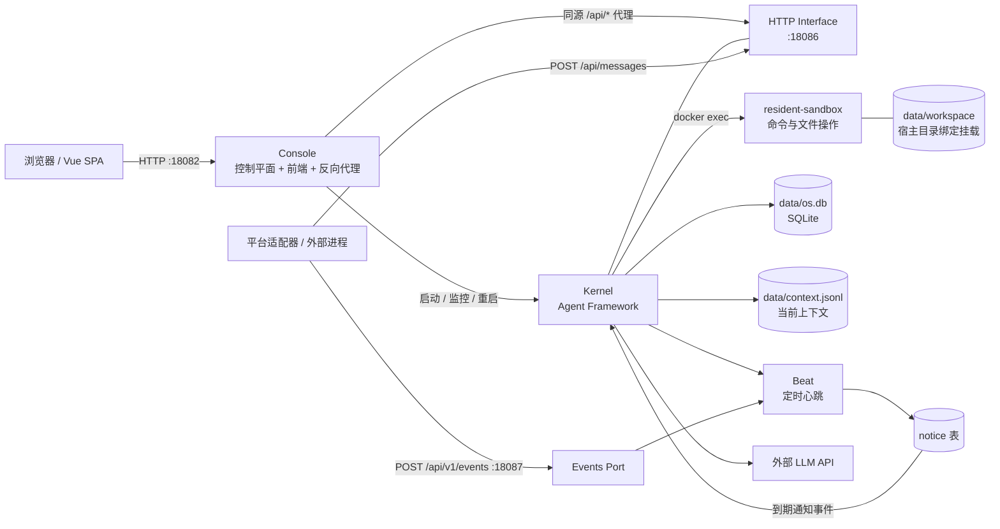
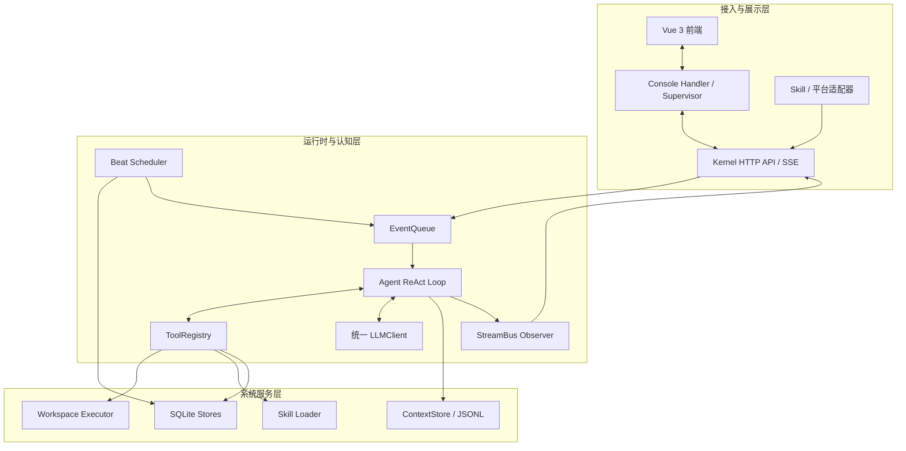
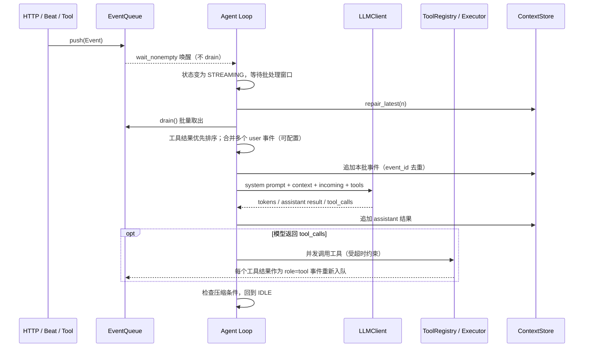

# Resident — Agent OS Kernel 架构文档

> **文档范围：** 基于 `Resident-win-test-v26.zip` 中的源码、配置、前端与部署文件整理。本文描述的是当前代码快照中的实际结构；对于仍处于预留阶段的接口，会明确标注，不把规划中的能力描述成已完成能力。
>
> **项目定位：** Resident 是面向 Agent 的轻量操作系统。Kernel 维持认知循环、事件入口、系统级状态与必要的基础接口；Skill/Application 是主要的能力扩展方式，Action 是具体操作入口，Messages 与 Notice 承担不同的信息输入职责，Memory 负责跨上下文与运行周期的长期连续性。本文同时区分设计原则与该代码快照中已实现的机制。

## 1. 设计目标与概念模型

Resident 的目标是构建一个**属于 Agent 的操作系统（Agent OS）**，而不是把所有能力都塞进一个庞大的 Agent Framework。Kernel 提供最少但可靠的常驻运行环境、认知循环、统一输入、系统级状态与必要的基础接口；应用层能力优先通过可独立安装、运行、替换和分发的 Skill 扩展。

Resident 的系统提示词 `config/prompt/system/kernel.md` 直接表达了这一定位：把 Kernel 描述为 Agent 自己使用的一台机器；把 Skill 定义为应用程序；鼓励 Agent 在现有能力不足时先查文档、读取 Skill、组合已有能力，必要时自行构建脚本、服务或新 Skill。系统提示词因此不仅描述工具用法，也承载了 Resident 对 Agent 身份、主动性、信息输入、记忆和能力演化的设计约定。

### 1.1 核心设计原则

1. **Kernel 尽可能轻量。** 内核只保留整个系统不可缺少、跨应用共享且需要统一保证的基础机制。新增内核功能前，先判断现有 Skill、Action、HTTP 接口和工作区工具能否完成；只有在系统确实缺少不可替代的公共能力时，才考虑内核化。
2. **Skill 是应用程序，也是主要扩展方式。** 平台适配器、业务流程、研究方法、自动化服务和复杂能力组合，优先封装成 Skill，而不是直接加入 Agent 主循环或内核工具层。复杂服务可以由 Skill 自己常驻运行，并通过配置与 HTTP 接口提供能力。
3. **Action 是具体操作入口。** 一个 Action 尽量只做一件明确的事。它可以是脚本，也可以是对 Skill 所持 HTTP 服务的薄封装；它是 Agent 把意图转化为实际操作的接口，不要求每个 Action 都注册成 Kernel 内置工具。
4. **Messages 与 Notice 是不同的信息入口。** Messages 保存真实外部对话，保留平台、会话、发送者和未读等语义；Notice 传达内部事件、任务结果、定时提醒和状态告警，不应伪装成某个人在对话。二者最终都可以进入 Agent 的认知上下文，但数据语义与管理渠道不同。
5. **上下文是工作缓存，Memory 承担长期连续性。** 当前上下文服务于眼前的推理；持久记忆、消息记录、工作区文件与归档则用于跨压缩、跨任务和跨重启恢复事实与状态。重要判断应能回查来源，不能把模型当前“还记得”当作持久化保证。
6. **渐进式披露，避免把所有知识塞进提示词。** 系统提示词常驻 Skill 索引，而不是每个 Skill 的完整正文；需要能力时再读取对应 `SKILL.md` 和参考文档。细节尽量留在应用文档中，系统提示词负责说明总体行为、边界与如何找到能力。
7. **主动性不等于持续输出。** 系统可因消息、到期 Notice 或主动窗口唤醒 Agent；唤醒只是给予处理机会，不代表必须制造动作。没有有价值的工作时，静默是正常状态。
8. **Agent 可以扩展自己的能力，但操作仍受现实边界约束。** 工具清单不是能力上限；Agent 可以研究、创建脚本或 Skill、运行服务、改进工作环境。但权限、法律、隐私、资源限制、外部服务风控和破坏性操作的可恢复性仍然重要。
9. **设计意图与已实现能力必须分开记录。** 概念上希望拥有某项能力，并不代表当前源码已经实现；架构文档对扩展预留、未闭环通道和部署依赖应明确标注。

### 1.2 概念与实现边界

| 概念 | 在 Resident 中的含义 | 当前实现或落点 | 重要边界 |
|---|---|---|---|
| Agent | 使用这套环境、保持长期连续性并对输入作出判断的认知主体 | `agent_framework/agent.py`、`context.jsonl`、工作区 | 当前主 Kernel 采用一个全局 Agent 与全局认知上下文，并非每个外部会话都拥有独立 Agent |
| Kernel | 支撑 Agent 常驻运行的轻量基础环境 | `src/kernel/agent_framework/`、`http_interface/`、`scheduler/`、`osdb/` | 应优先承载不可缺少的通用机制，避免成为所有业务能力的集合 |
| Skill / Application | 可发现、可按需读取、可独立分发的应用能力包 | 运行时 `data/workspace/.skills/<name>/`，以 `SKILL.md` 为入口 | Skill 可以是操作规范，也可以包含脚本、Actions、常驻服务、配置和测试；不要求全部是纯提示词 |
| Action | 面向一个具体操作的调用入口 | Skill 内的 `actions/` 脚本、适配器 HTTP Hook，以及部分 Kernel 工具 | 当前没有独立的全局 Action Registry 概念；Action 主要是 Skill 的组织约定和操作封装方式 |
| Messages | 外部平台中的真实对话与会话状态 | `messages` / `messages_archive` 表、消息 HTTP API、`messages_*` 工具 | 不等同于全部系统事件；适合“某个人/会话说了什么”的语义 |
| Notice | 系统主动递交给 Agent 的提醒、状态、内部任务结果 | `notice` 表、Notice API、Beat 到期投递 | 与 Messages 语义区分；不是独立会话，也不应伪装成外部发送者 |
| Memory | 跨上下文压缩和重启保存的重要事实、经验、知识与状态 | 工作区记忆文件、压缩时的 `need_archive.md`、归档与外部 Git 维护约定 | 四层记忆库结构属于 `resident_dev` 的推荐组织方式，并非 Kernel 自动强制的数据库 Schema |
| Beat | 系统时间与唤醒调度 | `src/kernel/scheduler/beat.py`、`cron.py` | 负责检查和投递，不代替 Agent 进行认知判断 |
| Console | 管理、状态观测、日志与控制入口 | `src/kernel/console/`、Vue 前端 | 属于管理面，不是 Agent 主要的认知主体 |
| Workspace | Agent 可读写、执行脚本、组织项目和持久化资料的工作环境 | `data/workspace/`，映射到容器 `/home/sandbox` | 工作区是能力构建与数据保存的通用基础，但宿主/容器模式的安全隔离不同 |

### 1.3 什么应该进入 Kernel，什么应该留在 Skill

这是 Resident 的重要架构决策规则，而不只是代码风格偏好。

**优先留在 Skill 的情况：**

- 能力服务于某个平台、某类业务、某种研究流程或某个可选工作流；
- 能力可用现有工作区工具、消息/Notice API、配置、Action 和独立进程实现；
- 能力需要快速迭代、独立依赖、独立配置或单独分发；
- 能力不是每个 Resident 部署都必需的，禁用它不应影响 Kernel 的基本运行；
- 复杂度主要来自外部协议、业务规则或流程编排，而不是系统级共享机制。

**才考虑加入 Kernel 的情况：**

- 整个系统确实普遍缺少该能力，且现有 Skill/API/Action 组合无法可靠弥补；
- 它是多种 Skill 都依赖的最小公共原语，应该由系统统一保证正确性、生命周期或安全边界；
- 把它放在 Kernel 能明显减少重复实现，并且不会把某种应用的业务规则固化为内核职责。

`qq_adapter` 与 `subagent` 是这种分层方式的例子：前者将 QQ 协议与平台行为留在独立适配器中；后者把 Hub、多 Agent 实例生命周期、审批、压缩与回滚作为独立服务维护。`resident_dev` 则为 Agent 提供应用开发规范、内核接口知识、记忆组织方法和主动探索地图，而不是将所有这些能力编写进 Kernel 代码。

### 1.4 当前实现快照

本文描述的是 `Resident-win-test-v26.zip` 中可见的源码、配置、前端与随包 Skill。文中的“设计原则”是 Resident 的目标与扩展约束；“当前实现”则以源码为准。例如，当前 Kernel 已包含消息、Notice、待办、工作区、图片读取、压缩及可选邮件等若干内置工具，但这不意味着今后每种新功能都应该内置。对于尚未分派的 Events Port、推荐但不强制的记忆库规范，以及依赖外部 Skill 的操作，都将在相应章节注明状态。


## 2. 总体架构

### 2.1 部署与进程关系



**默认端口与边界：**

| 服务 | 默认端口 | 说明 |
|---|---:|---|
| Console | `18082` | 浏览器实际访问入口；可由 `config/console.yaml` 或 Docker 部署配置调整绑定地址/端口 |
| Kernel HTTP Interface | `18086` | 聊天与管理 API；默认绑定 `127.0.0.1`，一般通过 Console 代理访问 |
| Events Port | `18087` | 单独的事件投递入口，默认绑定 `127.0.0.1` |
| Sandbox | `resident-sandbox`；部署脚本/Compose 暴露 `19090` 映射 | 长驻容器，Agent 通过 `docker exec` 执行命令和文件操作 |
| 可选 NapCat | WebSocket `3001`、WebUI `6099` | 由 `qq_adapter` Skill 及其部署脚本管理，不属于 Kernel 进程本身 |

Docker Compose 部署将 Console/Kernel 放在 `resident` 容器中，沙箱是单独容器；两者共享网络命名空间，沙箱工作区绑定到 `./data/workspace:/home/sandbox`。Compose 对宿主主要发布 Console 入口，Kernel 的 `18086` 和 Events Port 的 `18087` 不作为常规公网入口发布。

### 2.2 逻辑分层



这些层是**逻辑边界**，不是所有组件都运行在独立进程中。Console 与 Kernel 是独立进程；HTTP Interface、Agent、Beat、StreamBus 和存储对象通常在 Kernel 进程内协作；沙箱及某些 Skill 适配器则可作为独立容器/进程。

## 3. 进程启动与生命周期

### 3.1 Console 生命周期

入口：`python -m kernel.console --config config/console.yaml`。

1. 加载 `.env`，并检查/生成 `RESIDENT_API_KEY` 与 `RESIDENT_CONSOLE_TOKEN`。首次启动缺失或仍是占位值时生成随机 Token 并写回 `.env`。
2. 加载 `config/console.yaml`，初始化 `CoreManager` 与日志文件路径。
3. 启动独立 HTTP Server：提供静态前端、Console 自身 API，并把其余 `/api/*` 代理到 Kernel。
4. 后台 Supervisor 每约 2 秒检查 Kernel 状态；非预期退出时尝试拉起，Console 退出时停止托管的 Kernel。
5. Kernel 标准输出/错误被持续写入 `data/logs/kernel.log`，达到配置大小后轮转归档；日志 API 支持增量读取、级别和关键词过滤。

Console 负责的是**控制平面和入口聚合**，不承载主要的 Agent 推理循环。

### 3.2 Kernel 生命周期

入口：`python -m kernel.agent_framework --config config/agent.yaml`。

1. 加载 `.env` 和 YAML 配置，构建运行时配置对象。
2. 初始化 SQLite 数据库及存储对象：`MessagesStore`、`NoticeStore`、`SystemVarsStore`；加载待办 JSON。
3. 创建主 LLM Client，可选创建独立压缩模型 Client。
4. 创建 `WorkspacePath` 和 Workspace Executor；按配置注册工作区、消息、通知、待办、图片、Skill、压缩、邮件、重启等工具。
5. 生成动态系统提示词 Builder。提示词由身份信息、配置指定的 prompt 文件、运行时消息标识、Skill 清单和当前工具注册表组成。
6. 创建 `Agent`、`StreamBus` 和 Kernel HTTP 服务；按配置启动 Beat 与 Events Port。
7. 进入 Agent 主循环。
8. 退出时关闭 Beat、SSE Bus、HTTP Runner 和 SQLite 连接。
9. 如果收到 `system_reboot` 请求，则写入 `data/.reboot_pending` 后通过 `os.execv` 重新执行 Kernel。下一次启动发现标记后，向队列注入一条“系统已重新启动，请继续”的恢复事件。

Kernel 启动构造主要集中在 `src/kernel/agent_framework/__main__.py` 的 `build_agent()` 与 `main()`。

## 4. Agent 认知循环

### 4.1 状态机与输入队列

`AgentState` 包含四个状态：

- `IDLE`：等待新事件。
- `STREAMING`：准备输入、调用模型并接收流式输出。
- `TOOL_USE`：执行模型返回的工具调用。
- `COMPRESS`：进行上下文压缩。

`EventQueue` 是线程安全的 `deque`，支持 `push()`、`snapshot()`、`drain()` 和 `wait_nonempty()`。`wait_nonempty()` 只等待，不取走事件；Agent 先切换状态并等待一个短暂批处理窗口，再修复上下文尾部并一次性 `drain()`。这样短时间内到达的多个事件可以合并处理。



### 4.2 一轮处理的实际顺序

1. 等待队列非空，不提前消费。
2. 将状态切为 `STREAMING`，等待 `agent.event_batch_wait_seconds`。
3. 执行 `ContextStore.repair_latest()`，修复尾部不完整的 JSONL 条目或工具调用结构。
4. 排空队列。工具结果事件优先，其他事件保留相对顺序；按配置把多个 `role=user` 事件合并为一条，并保留批内合并提示。
5. 把本批事件立即追加到上下文并发布 `context_appended` 事件，让前端可以先显示收到的消息；用 `event_id` 避免失败重试时重复写入。
6. 组装模型输入：系统提示词、历史上下文、当前批中尚未写入/未被检查点覆盖的事件。然后修复工具调用与工具响应的配对，并按配置决定是否追加尾部空 user 消息。
7. 调用统一 LLM Client。模型的 token 增量经 Observer 发布；成功结果将 `assistant` 消息（文本、模型名、usage、reasoning 字段、provider items、tool calls 等可用字段）写入上下文。
8. 若模型返回工具调用，多个工具在同一轮通过 `asyncio.gather()` 并发执行。每个工具受 `tool_timeout_seconds` 约束；异常和超时转换为工具结果文本，不直接杀死主循环。结果作为 `role=tool` 事件重新进入队列，下一轮再交给模型。
9. 轮次结束时检查是否需要压缩，回到 `IDLE`。如果模型调用失败并耗尽 Adapter 层重试，本批事件会重新入队并退避重试；永久性配置错误可进入低频探测隔离状态。

**语义边界：** Resident 当前是一个全局 Agent/全局上下文，而不是每个平台会话各自维护一条独立的 Agent 对话。平台消息先进入消息库，再由 Beat 的唤醒逻辑挑选和组织为 Agent 输入；Agent 可通过消息工具查询会话细节。

### 4.3 Observer 与前端实时状态

Agent 不需要知道浏览器或 SSE 的存在，只发布结构化 Observer 事件。`StreamBus` 订阅这些事件，并提供：

- 有界事件历史，供新的 SSE 客户端回放；
- 多订阅者广播；
- 心跳消息，降低代理层空闲断连风险；
- 历史回放事件的 `_replay` 标记，避免前端重复渲染已由 `/api/context` 获取的内容；
- 关闭时主动通知 SSE 订阅端结束，避免重启被长连接拖延。

前端以 `context_appended` 维护时间线，以 token/工具事件显示当前轮的流式过程，并另外查询 `/api/queue` 显示尚未开始处理的事件。

## 5. 接入路径与事件流

Resident 当前有三条用途不同的输入路径，不应混为一谈。

### 5.1 直接 Agent 事件：`POST /api/event`

- 通过 Kernel HTTP Interface 接收 `{ role, content, kind }`。
- 内容允许字符串或 OpenAI 风格的多模态 block 列表。
- 校验后直接调用 `agent.push_event()`，绕过 Beat 的业务消息唤醒流程。
- 适合直接向认知循环注入一条事件。

### 5.2 平台消息数据：`POST /api/messages`

- 外部适配器将平台消息写入 `messages` 表；唯一键由 `platform + conversation_id + remote_message_id` 组合生成，并按消息类型去重。
- 消息内容、面向 LLM 的内容、发送者数据、原始段、收发方向、唤醒标记和是否已发送给 LLM 等字段由 `MessagesStore` 管理。
- Beat 定期读取未读/待处理消息，按唤醒策略构造带消息信封的 Agent 输入；Agent 需要更多上下文时可用 `messages_*` 工具回查。
- 已消费且超过保留期的消息可被 Beat 移入 `messages_archive`；未读消息不会按此路径归档。

QQ 示例适配器 `skills/qq_adapter/` 使用此路径：NapCat WebSocket 事件进入适配器，适配器调用 Core API 写消息；Agent 对外发送消息则调用适配器的 HTTP Hook/Actions。QQ 协议与收发细节不直接耦合进 Agent ReAct 循环。

### 5.3 独立 Events Port：`POST /api/v1/events`（端口 `18087`）

该入口接收 `{ "kind": { ... }, "payload": { ... } }`，鉴权通过后调用 `Beat.receive()`，事件先进入 Beat 内部线程安全队列。

> **当前实现状态：此入口仍是扩展预留通道。** 当前 `Beat._drain_events()` 会取出并记录事件日志，但尚未按 `kind` 分派处理，也不会自动把 `payload` 转换成 Agent 事件或 Notice。需要事件驱动能力的外部集成不能仅凭成功返回 `{ "ok": true }` 就假设 Agent 已被唤醒。

### 5.4 Notice 通道：Beat 到 Agent 的规范化入口

定时提醒、延迟通知、周期性 Cron 通知、后台任务完成等适合通过 `NoticeStore` 记录，由 Beat 在 tick 末尾检查是否到期。每条到期 Notice 都转成一条独立的 user 事件进入 Agent 队列。若存在短通知 `notification`，优先推送短文本；没有则使用完整 `content`。

Beat 不把 Notice 文本直接塞入模型请求，也不直接执行 Agent 的推理逻辑。它负责调度和标准化事件；实际的 user 消息批合并仍由 Agent 完成。

## 6. Beat：心跳、唤醒与定时任务

`src/kernel/scheduler/beat.py` 的 `Beat` 在 Kernel 的 asyncio Loop 中按配置的间隔运行，当前默认间隔为 5 秒。每个 tick 的主要顺序是：

1. **主动唤醒决策。** 检查未读消息与等待队列情况，按配置处理紧急消息、会话预览、未读窗口、去重和概率唤醒。唤醒概率等状态通过 `SystemVarsStore` 持久化。
2. **定时系统维护。** 按时间间隔将过期的已消费消息移入归档表；归档节奏和保留期由配置控制。
3. **处理 Events Port 队列。** 当前只记录收到的结构化事件，分派机制尚未实现。
4. **统一推送到期 Notice。** 查找到期的一次性/周期性通知，转换为 Agent 队列事件。

Cron 解析器在 `scheduler/cron.py`，采用五字段表达式：`分 时 日 月 周`，周日使用 `0`。Notice 存储本身只负责创建、查询、判定到期和维护执行状态；Beat 负责触发；Agent 负责理解并执行通知要求。

## 7. 工具系统与工作区执行

### 7.1 ToolRegistry

`ToolRegistry` 将工具名称、参数 Schema、描述和 Python handler 绑定起来。Schema 根据 handler 的参数签名/类型信息生成，之后同时用于向 LLM 声明工具以及生成系统提示词内的可用工具列表。工具结果统一转成文本返回给下一轮模型；工具异常被隔离，不应让整条 Agent 主循环崩溃。

当前构造阶段按功能注册的工具大体包括：

| 工具域 | 代表能力 | 相关模块 |
|---|---|---|
| 工作区 | 前台命令、异步命令、读写/编辑、Glob、Grep 等文件操作 | `workspace_tools.py`、`sandbox.py`、`fsops.py` |
| 消息 | 未读、会话/线程列表、区间查询、详细消息、归档查询、下载与清理已读 | `messages_tools.py`、`osdb/messages.py` |
| 通知 | 新建、查询、删除一次性/周期性通知 | `notice_tools.py`、`osdb/notice.py` |
| 待办 | 查询待办树、增加/更新任务与子项 | `todo_tools.py`、`osdb/todos.py` |
| Skill | 按目录名加载 `SKILL.md` 的完整内容 | `skills.py` |
| 图片 | 将图片读入上下文；可选上传图床 | `image_tools.py` |
| 压缩 | 主动请求上下文压缩（在安全点执行） | `compress_tools.py`、`compression.py` |
| 系统控制 | Kernel 自重启、暂停自说自话检测等运行工具 | `reboot.py`、`agent.py` |
| 邮件 | SMTP 发送 / IMAP 接收逃生通道；关闭时不注册 | `email_tools.py` |

工具最终是否注册取决于运行配置，例如 `email.enabled`、`readimage.enabled`、`skills.enabled` 和 `workspace_tools.enabled`。

### 7.2 Workspace Executor 与路径模型

`workspace_tools.mode` 决定工作区执行器：

- **`sandbox`（当前 `config/agent.yaml` 的常规配置）：** 命令和文件任务通过 `docker exec` 进入 `resident-sandbox`；工作区宿主目录 `data/workspace` 挂载为容器内 `/home/sandbox`。前台命令受超时/输出上限约束；后台任务进入 worker pool，结果 JSON 写入 `.tasks_log/`，可通过任务 ID 查询；异步完成通知可走 Notice 通道。
- **`host`：** 命令由宿主 shell 执行，文件操作由宿主解释器执行。它便于开发/排错，但当前不是安全沙箱；不能把路径映射误认为权限隔离。

`WorkspacePath` 负责宿主路径与容器路径的统一转换入口，并进行路径规范化/越界检查。Kernel 自己生成的文件（截断结果、后台任务结果、压缩提醒等）也通过执行器的 `runtime_path()` 转换成 Agent 当前运行环境里可访问的路径。

沙箱边界的安全假设需要特别注意：运行应用的容器挂载了 Docker Socket，Kernel 因此可以控制宿主 Docker。即便 Agent 命令在沙箱容器内执行，整个部署仍应作为高权限本机服务保护，不能视为抵御恶意宿主级攻击的强隔离环境。

## 8. LLM 适配层

所有模型供应商适配器实现统一接口：

```python
await llm.stream(messages, tools, on_delta) -> LLMResult
```

`LLMResult` 统一包含文本、可用的 reasoning/thinking、工具调用、usage，以及可选的供应商原始输出项。Agent 不需要根据供应商协议分支处理 ReAct 逻辑。

当前 Adapter 工厂位于 `agent_framework/llm/factory.py`：

| 配置协议 | 实现模块 | 说明 |
|---|---|---|
| `openai-compatible` | `llm/openai_compatible.py` | 兼容 Chat Completions 风格接口；可选 `generic`、`openai`、`deepseek`、`qwen`、`glm` 等变体 |
| `anthropic` | `llm/anthropic.py` | Anthropic Messages 风格接口 |
| `openai` / `responses` | `llm/responses.py` | OpenAI Responses API |

重试策略位于共享 LLM 基础层：针对网络、超时和可重试服务端错误执行指数退避；永久性 4xx 配置错误不应被无限高速重试。上下文请求过大时，Agent 可以在确实携带图像块的前提下移除图片块并重试一次。主推理模型与压缩模型可以分别配置；未启用独立压缩模型时压缩回退使用主模型。

模型能力/密钥/基础 URL 等由 `.env` 与 `config/agent.yaml` 共同给出。`llm.input` 显式声明模型接受的模态（当前支持文本和图片）；不能仅凭 `readimage.enabled` 就认为某个模型 API 一定接受图片。

## 9. 上下文与压缩

### 9.1 当前上下文

`ContextStore` 使用 `data/context.jsonl` 保存一行一个 JSON 消息的上下文，包含 user、assistant、tool 等角色，通常还带 `event_id`、来源、创建时间、模型名、usage、tool calls 等字段。

JSONL 兼顾可读性、顺序追加和故障修复。调用模型前会检查最近若干条记录，修复不完整的尾部 JSON/工具参数或丢弃无法安全修复的尾部条目；工具响应整理逻辑会补齐缺失响应并去除孤立/重复的 tool message，避免把错误工具协议传给模型。

### 9.2 两步压缩

达到 `compression.max_tokens * compression.threshold` 阈值后，系统执行两项相互独立的工作：

1. **记忆提取：** 根据 `config/prompt/memory_extraction.md` 抽取长期有用的记忆，并追加到 `data/workspace/memory/need_archive.md`。
2. **摘要与检查点：** 使用 `compression_summary.md` 生成压缩摘要，并保留预算范围内近期轮次，生成新的 checkpoint。

原始上下文会先复制归档到 `data/compressed/context-<timestamp>.jsonl`，活动上下文再以原子重写方式换成 checkpoint 与必要保留尾部。摘要模型多次失败时，系统使用结构化 fallback checkpoint，避免因摘要失败让上下文永远无法降到预算内。尚未被模型消费的事件尾部会特殊保留或记录到 checkpoint 的 `covered_event_ids`，以避免压缩后当前批事件重复输入。

压缩既可能在发起 LLM 调用前运行（防止过长上下文请求持续失败），也会在一轮成功后检查。配置包括上下文 token 估算、触发阈值、近期保留预算、摘要提示文件、记忆提取开关和归档目录。

## 10. 持久化模型与数据目录

Resident 有意把认知上下文、系统数据库、配置与用户工作区分开。

| 路径 | 存储内容 | 维护方式 |
|---|---|---|
| `data/context.jsonl` | 当前认知上下文与工具交互历史 | `ContextStore` 追加、修复、压缩重写 |
| `data/compressed/` | 被压缩前的上下文 JSONL 归档 | `ContextStore` / `compression.py` |
| `data/os.db` | SQLite 数据库：消息、消息归档、Notice、系统变量等 | `Database` 与各 Store；访问由线程锁保护 |
| `data/todos.json` | 两层待办任务树 | `TodoStore`，使用临时文件 + 替换方式保存 |
| `data/workspace/` | Agent 工作区、用户文件和可被沙箱访问的内容 | `WorkspacePath` / Executor / 工具 |
| `data/workspace/.skills/` | 运行时 Skill 包 | 安装脚本/控制台上传/Skill 管理器 |
| `data/workspace/.tasks_log/` | 后台执行任务结果 JSON | Workspace Executor |
| `data/workspace/.truncated/` | 被截断输出的完整内容 | 工具输出限长机制 |
| `data/workspace/memory/need_archive.md` | 记忆提取阶段追加的长期记忆候选 | 压缩模块 |
| `data/logs/kernel.log` | Kernel stdout/stderr | Console 管理、轮转、tail |
| `data/config_backups/` | 控制台在线修改配置前的备份 | Console 配置管理器 |
| `data/skill_backups/`、`data/skill_trash/` | 覆盖 Skill 前的备份与删除后的回收内容 | Skill 管理器 |
| `.env` | LLM/API/图床/邮件等密钥及机器相关值 | Console 首启自举；不应提交版本库 |
| `config/` | YAML 参数、系统提示词和调度提示文件 | 版本控制/配置视图；启动时加载配置 |

### 10.1 SQLite 当前主要职责

- `messages`：标准化平台消息，存储平台/会话/远端消息 ID、内容、原始段、收发方向、唤醒状态及已被 LLM 消费标记。
- `messages_archive`：同形状的历史消息归档表。
- `notice`：一次性或 Cron 通知；字段包括到期时间、Cron 表达式、正文、优先展示的短通知、完成状态和上次运行时间。
- `system_vars`：跨重启的小型系统状态键值，如会话 ID、上次归档时间、唤醒概率等。

待办树不在 SQLite 中，而是在 `data/todos.json`。当前提示词和 Skill 文件也不是 OSDB 的内容来源。

## 11. 系统提示词、Agent 行为契约与 Skill/Application

系统提示词是 Resident 对 Agent 的“操作环境说明书”和行为契约。它不仅说明有哪些工具，还说明 Agent 如何理解自己的环境、怎样处理输入、如何看待长期记忆、何时主动行动、怎样保持静默，以及扩展能力时应优先使用什么机制。它不是 Kernel 本身，也不能替代代码层的权限校验、路径防护、鉴权与失败处理。

### 11.1 提示词并非单一文件

`src/kernel/agent_framework/prompts.py` 使用动态 Builder 组合提示词，当前顺序如下：

1. **身份头部：** 从配置生成项目名、真实模型名与容器内工作目录。
2. **静态提示词文件：** `config/agent.yaml` 的 `prompt.files` 当前依次加载 `config/prompt/system/kernel.md` 和可选的 `config/prompt/user/persona.md`。前者定义系统级运行理念、机制、边界、语气、主动性与 Skill 规范；后者是部署方可自定义的人设示例。
3. **运行时消息标识块：** `runtime_block.py` 根据当前配置和代码使用的共享常量，动态生成外部消息信封、唤醒引导、会话预览、Notice、后台任务完成、重启、静默与图片标记说明；功能关闭时相应说明也会调整。
4. **Skill 索引：** 扫描运行时 Skill 目录，只注入目录名以及 `SKILL.md` front matter 的 `name` / `description`。
5. **工具目录：** 从实际 `ToolRegistry` 生成当前可用工具与参数描述，减少系统提示词与注册状态不一致。

此外，`compression_summary.md`、`memory_extraction.md` 和 `compression_reminder.md` 分别服务于上下文摘要、记忆提取和压缩提醒，不是每轮都完整拼入主系统提示词的同一层内容。

### 11.2 `kernel.md` 表达的行为模型

当前主系统提示词的核心约定可归纳为：

- **把环境视为 Agent 自己使用的机器：** 工作区、文件、脚本、项目、通信渠道和时间表可以持续积累；对话结束不等于环境和历史消失。
- **工具清单不是能力上限：** 可以先查资料、组合现有能力，必要时研究并创造脚本、服务或 Skill；但执行能力始终受到实际权限、资源、网络和安全边界约束。
- **上下文是短期工作缓存：** 重要事实应写入可回查的文件、记忆库或消息记录；压缩后不能假定遗失的对话仍在当前工作记忆里。
- **系统消息进入同一认知过程，但需辨别来源：** 外部对话、Notice、唤醒提醒、后台任务结果等在模型上下文层可能都以 `user` 角色呈现，因此通过信封与标记区分来源；底层 Messages 与 Notice 仍保留不同的数据语义。
- **有主动性，但没有强制主线：** 新消息、到期 Notice 或自由活动窗口都可唤醒 Agent；是否行动由 Agent 判断，没有值得处理的事情时允许静默。
- **Skill 是应用程序，也是能力沉淀的主要载体：** 使用能力前先读对应 Skill，不凭名字猜用法；新业务优先封装为 Skill，长期使用后再演化、复用或拆分。
- **边界与恢复能力是持续运行的前提：** 对外操作要明确实际送达渠道；涉及删除、覆盖、公开发布、权限调整等高影响行为，要考虑影响范围和恢复办法。

因此，`kernel.md` 应说明全局规则和如何找到能力；具体应用的协议、参数、输入事件、Action、测试用例与运行方式，应主要写在 Skill 自身文档内，而不是不断增肥主提示词。

### 11.3 Skill 采用渐进式披露

`src/kernel/agent_framework/skills.py` 扫描 `data/workspace/.skills/<name>/SKILL.md`。系统提示词只列出目录与触发描述；`skills_load` 工具按目录名返回指定 Skill 的完整 `SKILL.md`。因此：

- 已安装 Skill 在提示词层面可被发现，但完整说明仅在需要时加载；
- 安装新 Skill 不要求为它修改 Agent 主循环；下一次重新构建提示词时可以发现新条目；
- Skill 文档既是给人阅读的接口说明，也是 Agent 按需展开能力时的入口；
- Skill 包可以携带自己的 `actions/`、`src/`、`config/`、`tests/`、启动脚本及服务，不必把业务逻辑搬进 Kernel。

### 11.4 Skill/Application 与 Action

源代码随包提供的 `skills/` 是安装种子；运行时使用的 Skill 以配置指定的工作区目录为准。当前预装 Skill 展示了三种应用方向：

- `qq_adapter`：消息平台适配器，承担 OneBot11/NapCat 通信、收发消息、平台动作、白名单和注意力相关逻辑；通过 Kernel API 接入，而不把 QQ 协议写进认知循环。
- `subagent`：独立运行的多 Agent Hub，负责实例生命周期、任务派遣、审批、上下文压缩、checkpoint 与回滚；它是应用级服务，不代表 Kernel 内置了完整的多 Agent 调度器。
- `resident_dev`：面向 Agent 的开发参考应用，提供 Kernel HTTP 接口、Skill 开发规范、行为/探索地图和记忆组织建议，帮助 Agent 构建或维护更多应用能力。

在 Skill 规范中，Action 是一个明确的操作入口，原则上一次只执行一个具体动作；如果 Skill 有常驻服务，Action 通常通过 HTTP 调用该服务，业务逻辑保留在服务内部。`actions/README.md` 作为动作索引，配置进入 `config/`，运行数据进入 `skill_data/<name>/`，密钥独立存储。当前 Kernel 没有独立的全局 Action Registry；不要将 Skill 内的 Action 目录误解为 Kernel 内置工具列表。

### 11.5 Kernel 与 Skill 的扩展决策

新增能力时，先检查：已有 Action、工作区工具、HTTP API、Messages/Notice、Beat 和现成 Skill 是否足以组合完成。如果可行，优先留在 Skill/Application。只有整个系统缺少不可替代、跨应用共享且需要由 Kernel 统一保证的基础能力时，才考虑添加 Kernel 功能。这样可以让 Kernel 维持小而稳定的公共机制，同时让应用按需求独立迭代与分发。

---


## 12. HTTP API 与 Console 路由

### 12.1 Console 端点

以下端点由 Console 直接处理；所有 `/api/*` 请求在 Console 层都需要携带 `RESIDENT_CONSOLE_TOKEN`：

| 方法 | 路径 | 用途 |
|---|---|---|
| `GET` | `/api/status` | Console/Kernel 存活状态、PID、Kernel URL 等 |
| `GET` | `/api/logs` | 增量读取 Kernel 日志，可按级别/关键词过滤 |
| `POST` | `/api/control/start` | 启动或确保 Kernel 运行 |
| `POST` | `/api/control/stop` | 停止 Kernel |
| `POST` | `/api/control/restart` | 重启 Kernel |
| `GET` | `/api/config/files` | 列出允许在线查看的配置文件 |
| `GET` | `/api/config/file?path=...` | 读取配置文件 |
| `POST` | `/api/config/file` | 保存配置文件，保存前备份 |
| `GET` | `/api/config/schema?path=...` | 获取 YAML 的结构化配置视图 Schema |
| `POST` | `/api/config/update` | 按路径更新配置项，保存前备份 |

Console 没有单独实现的其余 `/api/*` 路径会代理至 Kernel HTTP Interface，并注入 Kernel API Token。SSE 响应按流逐行转发，不缓冲整条对话。

### 12.2 Kernel HTTP Interface 端点

| 方法 | 路径 | 用途 |
|---|---|---|
| `GET` | `/api/stream` | SSE 事件流 |
| `POST` | `/api/event` | 直接向 Agent 队列推送事件 |
| `GET` | `/api/state` | Agent 状态、轮次、工具清单、队列长度等 |
| `GET` | `/api/queue` | 查看尚未从 Agent 队列取走的事件 |
| `GET` | `/api/context?n=...` | 读取当前上下文，可限制返回最近条数 |
| `GET` | `/api/health` | Kernel HTTP 健康检查 |
| `POST` | `/api/image` | 可选图床上传；图床未启用时返回未启用错误 |
| `GET` / `POST` | `/api/messages` | 查询指定会话消息 / 写入新消息 |
| `GET` | `/api/messages/unread` | 查询待处理未读消息 |
| `GET` / `POST` | `/api/messages/archive` | 查询归档消息 / 将过期已读消息归档 |
| `GET` / `POST` | `/api/notice` | 列表 / 新建通知 |
| `GET` / `DELETE` | `/api/notice/{id}` | 查询 / 删除单条通知 |
| `GET` | `/api/skills` | 列出 Skill |
| `GET` | `/api/skills/detail?name=...` | 读取 Skill 正文 |
| `POST` | `/api/skills/install` | 上传并安装 Skill ZIP |
| `POST` | `/api/skills/delete` | 删除 Skill（移动到回收目录） |

Kernel 的 `/api/*` 使用 `RESIDENT_API_KEY` 鉴权。SSE 的浏览器 `EventSource` 无法设置自定义请求头，所以前端需通过 `?token=` 传递 Kernel 代理所需 Token；正常情况下该请求先经过同源 Console。

Events Port 是不同服务/端口：`POST /api/v1/events`，`GET /api/health`。它用于接收外部结构化事件，当前事件 `kind` 尚未实现分派。

## 13. 配置职责

| 配置位置 | 应该放什么 | 示例内容 |
|---|---|---|
| `.env` | 密钥、机器相关设置和部署时注入值 | LLM 地址/Key/模型、Console Token、Kernel API Key、图床/邮件凭据、Python 解释器、镜像源 |
| `config/agent.yaml` | Agent、HTTP、LLM、压缩、Beat、Skill、消息、工作区等运行参数 | 超时、端口、输入模态、唤醒阈值、保留预算、工作区执行模式 |
| `config/console.yaml` | Console 监听、托管方式、日志、配置编辑边界、Kernel URL | Console 端口、Kernel module/args、配置白名单根目录 |
| `config/prompt/` | 面向模型的身份行为、压缩、记忆提取等说明 | 系统提示词文件、记忆提取提示、压缩摘要提示 |
| `config/schedule/` | 调度时注入的提示文案 | 无新消息时主动活动窗口提示 |

YAML Loader 会展开 `${ENV_NAME}` 环境变量引用；被引用的变量不存在时会抛出配置错误，而不是默默替换为空字符串。多数运行参数是在 Kernel 启动时读取的，因此编辑配置文件后一般需要重启 Kernel 才能让参数生效。动态系统提示词每轮重新渲染工具清单与 Skill 清单，但这不等于所有配置更改都支持热加载。

## 14. 安全模型与运维边界

### 14.1 两层 API 鉴权

1. **浏览器 → Console：** `RESIDENT_CONSOLE_TOKEN`，可从 `X-Api-Token`、Bearer Header 或 query token 读取；比较使用常量时间比较函数。
2. **Console → Kernel：** 代理转发时注入 Kernel API Token；Kernel 自己再次鉴权。直接访问 Kernel 的调用方也必须提供 `RESIDENT_API_KEY`。
3. **Events Port：** 自己有鉴权中间件；当前配置示例把其 key 与 Kernel API 使用同一环境变量，但配置字段彼此独立。健康检查路径 `/api/health` 不要求 Events Port Token。

默认仅绑定 loopback。不要未经保护就把 Console 暴露到公网；远程访问建议走 SSH 隧道或具备 TLS/访问控制的反向代理，并保留应用层 Token。

### 14.2 沙箱和高权限

- `workspace_tools.mode: sandbox` 将 Agent 命令放进 `resident-sandbox`，但负责调用 Docker 的 `resident` 容器需要访问宿主 Docker Socket。
- Docker Socket 等同于很高的宿主 Docker 控制权限。因此，“命令在独立容器执行”不代表该部署能抵御拥有 Kernel 工具权限的恶意输入或容器逃逸问题。
- `workspace_tools.mode: host` 不提供强隔离，应只用于可信环境下的开发/诊断。
- `.env` 包含 API Key、邮件凭据等秘密，不应提交版本控制、打包外发或写入 Skill 分发内容。
- Skill ZIP 上传路径有文件数、总大小和 ZIP 大小限制；仍应只安装可信来源的技能包，因为 Skill 内容可能指导 Agent 调用现有工具或访问外部服务。

## 15. 已知边界与扩展位置

这些不是推测出来的架构目标，而是阅读当前源码时应保留的事实边界：

1. **Events Port 尚未完成事件分派。** 当前只验证、入队并记录日志，不会自动向 Agent 投递事件。要实现外部事件触发 Agent，需要在 Beat 中定义 `kind` 协议、校验 payload、去重/重试语义，并明确转换为 Notice 还是 Agent Event。
2. **一个全局 Agent 上下文。** 当前消息来源可以很多，但认知循环和 JSONL 上下文只有一个；按会话隔离的多 Agent/多上下文需要在上层新增明确的路由和生命周期设计。
3. **`host` 执行模式不是沙箱。** 配置中存在该模式，但它只负责运行位置与路径适配，不提供与容器相同的隔离边界。
4. **Skill 不是内核工具的替代品。** Skill 主要提供按需加载的流程、规范和外部服务能力说明；真正能调用的工具必须已经在注册表中，或由 Skill 调用的外部程序/服务自行提供。
5. **平台入站与平台出站分离。** 消息表能标准化保存多平台消息，但“如何发回某个平台”仍由相应适配器实现；Resident 核心并不内置所有平台协议。
6. **上下文压缩不等于完整数据库归档。** 压缩管理的是 LLM 对话上下文；消息库有自己的归档表，待办与工作区文件也有各自的持久化逻辑。

建议扩展时遵循下列方向：

- 新 LLM 协议：实现统一 `LLMClient.stream()` 接口并在 `llm/factory.py` 中注册。
- 新的原生工具：编写 handler，在 `build_agent()` 注册；同步考虑参数 Schema、超时、错误文本、输出上限和权限边界。
- 新平台：独立实现适配器，通过 `/api/messages` 存储消息，使用消息/Notice API 实现与 Agent 的唤醒协作，并独立处理平台发出消息的协议。
- 新事件种类：完善 Events Port 与 Beat 的 `kind` 分派，写清楚幂等、确认、失败重试以及它如何进入 Notice/Agent 队列。
- 新 Skill：以 `SKILL.md` 描述触发条件、输入/输出、外部依赖、配置、秘密与权限；不要把密钥写入分发包。

## 16. 关键源码索引

| 关注点 | 入口文件 |
|---|---|
| Kernel 装配、工具注册、启动/退出 | `src/kernel/agent_framework/__main__.py` |
| Agent 状态机、ReAct 循环、工具调用、LLM 失败恢复 | `src/kernel/agent_framework/agent.py` |
| 事件对象与线程安全队列 | `src/kernel/agent_framework/events.py` |
| 上下文 JSONL、修复、压缩接口 | `src/kernel/agent_framework/context.py` |
| 两步压缩与 checkpoint | `src/kernel/agent_framework/compression.py` |
| 系统提示词组装 | `src/kernel/agent_framework/prompts.py`、`runtime_block.py` |
| 工具注册与 Schema 生成 | `src/kernel/agent_framework/tools.py` |
| LLM 协议统一接口和工厂 | `src/kernel/agent_framework/llm/` |
| 工作区执行器、沙箱与异步任务 | `src/kernel/agent_framework/sandbox.py`、`workspace_tools.py`、`fsops.py` |
| Workspace host/container 路径转换 | `src/kernel/agent_framework/paths.py` |
| Beat 心跳、唤醒、通知投递 | `src/kernel/scheduler/beat.py`、`cron.py` |
| Kernel HTTP API | `src/kernel/http_interface/server.py` |
| SSE 广播与回放 | `src/kernel/http_interface/eventbus.py` |
| 外部事件入口（预留分派） | `src/kernel/http_interface/events_port.py` |
| SQLite 与消息/通知/系统变量持久化 | `src/kernel/osdb/` |
| Console、Supervisor、反向代理 | `src/kernel/console/app.py`、`config_admin.py` |
| 前端入口、API 客户端与页面 | `frontend/src/` |
| 默认参数与提示词 | `config/agent.yaml`、`config/console.yaml`、`config/prompt/` |
| Docker/沙箱部署 | `compose.yml`、`docker/`、`scripts/` |
| Skill 开发规范与 API 参考 | `skills/resident_dev/` |
| 子代理 Skill 自身架构 | `skills/subagent/ARCHITECTURE.md` |

---

**维护约定：** 当核心进程拓扑、事件语义、存储模型、鉴权边界或工具注册机制变化时，应同步更新本文对应章节。对预留接口应明确写出“当前已实现 / 当前未实现”，避免架构文档成为目标态描述而与源码脱节。
